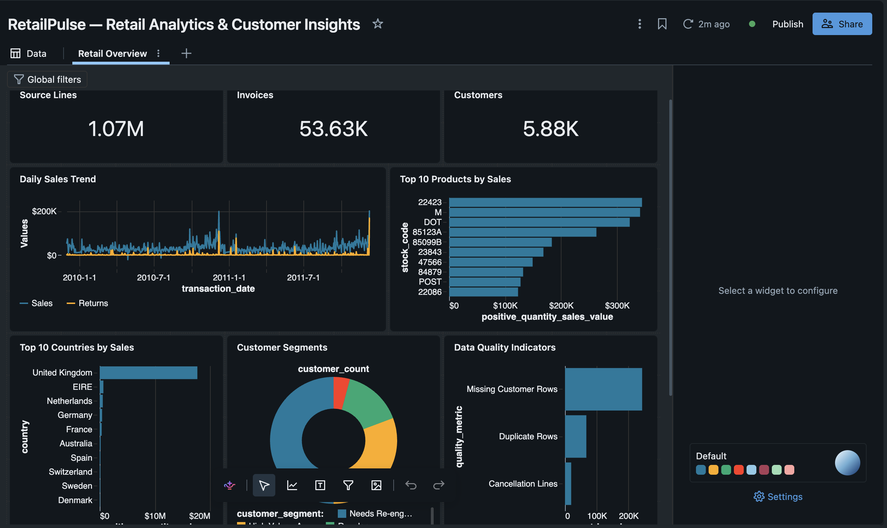
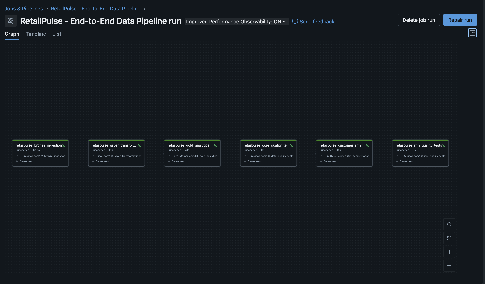
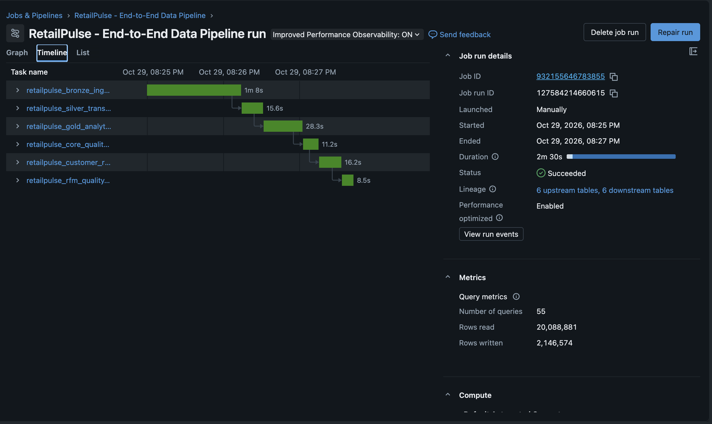

# RetailPulse — Retail Data Engineering Lakehouse

An end-to-end retail data engineering portfolio project built with **Databricks, PySpark, Spark SQL and Delta Lake.

RetailPulse transforms the UCI Online Retail II dataset into a structured Bronze–Silver–Gold lakehouse, applies data-quality validation, orchestrates notebook workflows and produces analytical datasets for retail business insights.

# Project Screenshots

 Databricks SQL Dashboard

 Lakeflow Job Workflow

 Pipeline Execution

# Sample Data

The original Online Retail II dataset is not committed to this repository.

Download it from the [UCI Machine Learning Repository](https://archive.ics.uci.edu/dataset/502/online+retail+ii).

The local export script converts the workbook sheets into CSV files for ingestion.

Expected local files:

- `data/raw/online_retail_2009_2010.csv`
- `data/raw/online_retail_2010_2011.csv`

The `data` directory is excluded from Git to avoid committing large raw dataset files. Follow the project setup instructions in the main README before running the export and profiling scripts.

# Project Overview

The project demonstrates a complete data engineering workflow:

- Source data exploration and profiling
- Bronze-layer ingestion using Apache Spark
- Silver-layer data cleaning and transformation
- Gold-layer analytical data modelling
- Data-quality testing and validation
- Customer segmentation using RFM analysis
- Workflow orchestration using Databricks Lakeflow Jobs
- Business analytics and dashboard development

# Architecture

Bronze → Silver → Gold

| Layer | Purpose |
| |     |
| Bronze | Ingests source retail transactions into Delta Lake |
| Silver | Standardises data, handles quality issues and creates derived fields |
| Gold | Produces analytical datasets for sales, products, countries and customers |

# Technology Stack

- Databricks
- Apache Spark / PySpark
- Spark SQL
- Delta Lake
- Python
- Git and GitHub

# Dataset

The project uses the UCI Online Retail II dataset, containing historical transactions from December 2009 to December 2011.

The combined source data contains approximately 1.07 million transaction rows.

Raw dataset files are excluded from this repository.

# Repository Structure

retailpulse-databricks-lakehouse/
├── docs/
├── notebooks/
├── reports/
├── sample_data/
├── scripts/
├── sql/
├── src/
├── databricks.yml
├── requirements.txt
├── .gitignore
└── README.md

# Pipeline and Analytics

The project includes:

- Bronze and Silver Delta tables
- Gold daily sales, product performance and country performance tables
- Customer RFM segmentation
- Data-quality validation notebooks
- Databricks Lakeflow Job orchestration
- A retail analytics dashboard

# Data Quality

The pipeline includes checks for row-count preservation, missing identifiers, duplicate groups, invalid quantities, pricing issues and analytical table consistency.

# Important Project Note

The current Lakeflow workflow uses overwrite-based full refreshes. Incremental ingestion and production deployment are not claimed as implemented features.

# Project Status

Completed portfolio implementation with ongoing documentation and repository improvements.

Author: Charlie  
Project: RetailPulse — End-to-End Retail Data Engineering Lakehouse